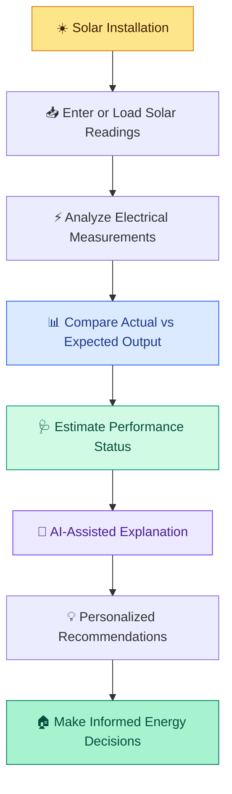
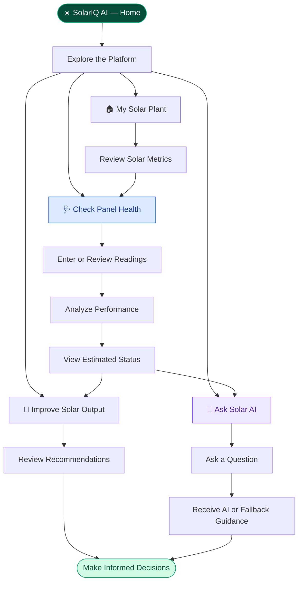
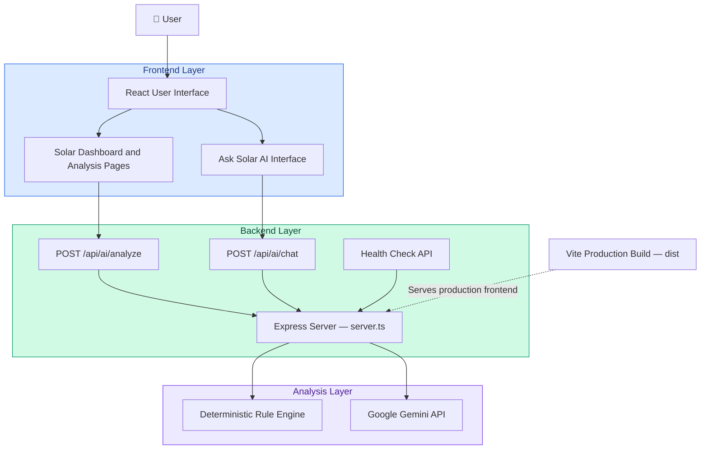
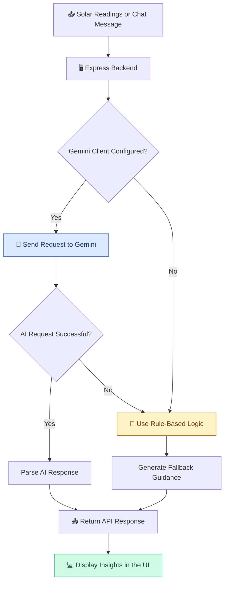
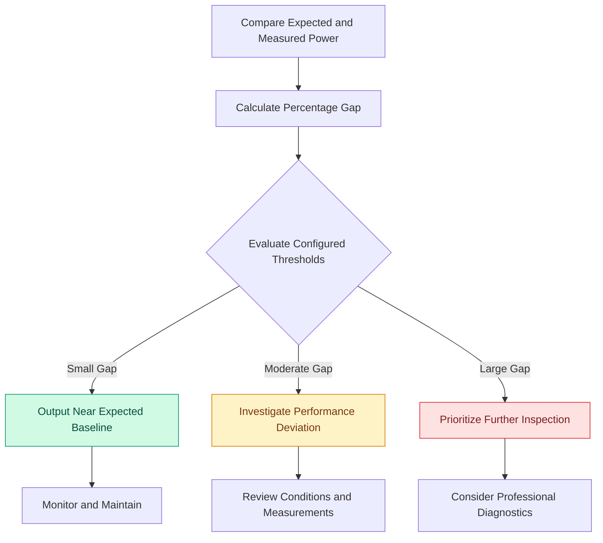
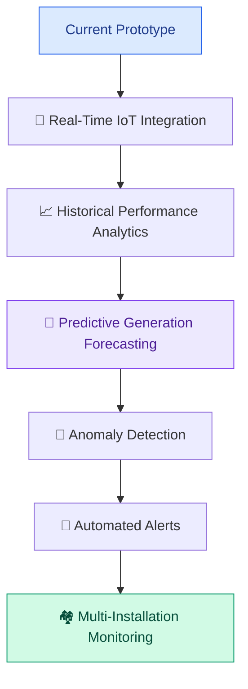

<div align="center">

# ☀️ SolarIQ AI

### Understand Your Solar. Improve Your Energy.

**An AI-powered solar energy optimization and panel health monitoring platform.**

Monitor solar performance, analyze power output, understand potential efficiency losses, and discover actionable ways to make better use of solar energy.

<br/>


<br/>

**Turning solar data into understandable insights and smarter energy decisions.**

<br/>

[Explore the Repository](#-getting-started) · [Architecture](#-system-architecture) · [Features](#-key-features) · [Future Scope](#-future-scope)

</div>

---

## 📑 Table of Contents

* [🌍 The Problem](#-the-problem)
* [💡 Our Solution](#-our-solution)
* [✨ What Makes SolarIQ AI Different?](#-what-makes-solariq-ai-different)
* [🚀 Key Features](#-key-features)
* [🗺️ Website Navigation Flow](#️-website-navigation-flow)
* [🏗️ System Architecture](#️-system-architecture)
* [⚙️ How the AI Analysis Works](#️-how-the-ai-analysis-works)
* [📊 Solar Performance Analysis](#-solar-performance-analysis)
* [🧰 Technology Stack](#-technology-stack)
* [🖥️ Installation and Local Setup](#️-installation-and-local-setup)
* [🔐 Environment Variables](#-environment-variables)
* [🌐 Deployment](#-deployment)
* [🎯 Use Cases](#-use-cases)
* [🛣️ Future Scope](#️-future-scope)
* [⚠️ Limitations and Disclaimer](#️-limitations-and-disclaimer)
* [🤝 Contributing](#-contributing)
* [👨‍💻 Author](#-author)

---

# 🌍 The Problem

Solar energy is clean, renewable, and increasingly accessible. However, simply installing solar panels does not guarantee that a solar installation is consistently performing as expected.

Homeowners and small solar system operators may face several challenges:

| Problem                             | Why It Matters                                                                    |
| ----------------------------------- | --------------------------------------------------------------------------------- |
| 📉 Unexpected performance gaps      | Actual power output may be lower than the expected baseline.                      |
| 🌡️ Temperature-related losses      | High operating temperatures can reduce panel efficiency.                          |
| 🌳 Dust and partial shading         | Environmental conditions may reduce the sunlight reaching panels.                 |
| 📊 Difficult-to-understand readings | Electrical measurements are not always easy for non-technical users to interpret. |
| 💬 Lack of accessible guidance      | Users may struggle to decide what to check or how to optimize energy usage.       |

### The Core Challenge

> **How might we transform solar performance readings into understandable health insights and practical energy optimization recommendations?**

SolarIQ AI addresses this challenge by bringing solar performance monitoring, rule-based analysis, and conversational AI together in one interface.

---

# 💡 Our Solution

## Introducing SolarIQ AI

SolarIQ AI is a web-based solar energy assistant designed to help users understand their solar installation's performance.

It combines numerical analysis, configurable health classifications, actionable recommendations, and Gemini-powered explanations to make solar insights easier to understand.

### 🔄 From Raw Data to Actionable Insights



### Our Goal

* Make solar performance easier to understand.
* Highlight deviations from expected power output.
* Explain possible causes without presenting unverified faults as confirmed diagnoses.
* Suggest practical ways to improve solar energy utilization.
* Make solar guidance accessible through a conversational interface.

---

# ✨ What Makes SolarIQ AI Different?

## 1. 📊 Data-Driven Performance Insights

Rather than relying only on generic solar tips, SolarIQ AI uses available performance readings to explain the difference between expected and measured output.

## 2. 🧠 Hybrid Intelligence

The platform combines deterministic calculations and rules with Gemini-generated explanations.

This approach helps separate numerical calculations from natural-language guidance.

## 3. 💬 Conversational Solar Assistance

Users can ask questions in everyday English instead of needing to understand every technical measurement.

## 4. 💡 Actionable Optimization

The platform focuses on what users can do next, including checking for shade, considering panel cleanliness, and scheduling flexible electricity consumption during productive solar hours.

## 5. 🛡️ Explainable and Cautious Analysis

A performance gap can indicate that further investigation is worthwhile, but it does not independently prove that a panel is damaged.

SolarIQ AI distinguishes possible causes from verified faults.

## 6. 🔄 Rule-Based Fallback

If the Gemini client is unavailable or a request fails, the backend can return rule-based guidance for supported analysis and chat requests.

This provides a fallback path, although it does not guarantee uninterrupted service in every failure scenario.

---

# 🚀 Key Features

### 🏠 1. My Solar Plant

A central overview of the solar installation.

* View available solar performance metrics.
* Understand actual versus expected output.
* Review available panel status information.
* Explore the relationship between sunlight, panels, electricity, and household consumption.

### 🩺 2. Check Panel Health

An interactive performance assessment interface.

* Review measured electrical power.
* Compare actual and expected output.
* Consider operating temperature and other available readings.
* Display a health classification based on configured rules.
* Explore possible reasons for performance differences.

**Important:** The classification is an estimate based on available inputs and configured rules, not a certified hardware diagnosis.

### 🌱 3. Improve My Solar Output

Practical recommendations to support better energy utilization.

Examples include:

* Inspecting for dirt, leaves, or bird droppings.
* Checking whether trees or nearby structures cast shadows.
* Reviewing operating temperature and ventilation.
* Considering professional inspection when significant deviations persist.
* Scheduling flexible household loads around available solar generation.

### 🤖 4. Ask Solar AI

A conversational assistant powered by the Google Gemini API when properly configured.

Users can ask questions such as:

* Why is my solar power output lower than expected?
* How does high temperature affect solar panels?
* When should I run high-power appliances?
* What should I check if my performance gap increases?
* How can I make better use of daytime solar energy?

### 🧮 5. Rule-Based Analysis

The backend includes deterministic rules that produce structured assessments and recommendations.

This provides a fallback when Gemini is not configured or an AI request fails.

### 📱 6. Web-Based Experience

The application combines an interactive frontend with a backend API, making it accessible through a web browser without requiring a dedicated mobile application.

---

# 🗺️ Website Navigation Flow

The following diagram describes the intended user journey through SolarIQ AI.



*The diagram represents the platform's intended navigation and workflow. Individual features should be verified against the deployed application.*

---

# 🏗️ System Architecture

SolarIQ AI uses a frontend-backend architecture with a Gemini integration and a rule-based fallback path.



### Architecture Components

| Component             | Responsibility                                                               |
| --------------------- | ---------------------------------------------------------------------------- |
| React                 | Renders the interactive user interface.                                      |
| Vite                  | Supports frontend development and production builds.                         |
| Express               | Handles HTTP requests and backend routes.                                    |
| TypeScript            | Adds static typing to the backend code.                                      |
| Google Gemini API     | Generates natural-language solar analysis and chat responses when available. |
| Rule-based engine     | Produces deterministic analysis and fallback guidance.                       |
| Environment variables | Configure sensitive values such as the Gemini API key.                       |

### Backend API Routes

| Method | Endpoint          | Purpose                                                                     |
| ------ | ----------------- | --------------------------------------------------------------------------- |
| `GET`  | `/api/health`     | Reports server health and whether the Gemini client is configured.          |
| `POST` | `/api/ai/analyze` | Analyzes solar telemetry and returns structured insights.                   |
| `POST` | `/api/ai/chat`    | Answers solar-related questions using chat history and available telemetry. |

---

# ⚙️ How the AI Analysis Works

SolarIQ AI follows a hybrid analysis approach.



### Step 1 — Collect Readings

The analysis endpoint accepts values such as:

* Panel temperature
* Array voltage
* Array current
* Measured power
* Expected power
* Solar irradiance
* Performance gap
* Installation name

These values may be supplied by the user interface or demo data, depending on the application's configuration.

### Step 2 — Calculate and Compare

The system evaluates the available measurements and the difference between measured and expected output.

### Step 3 — Generate Insights

When the Gemini integration is configured and the request succeeds, Gemini can provide a natural-language explanation.

When that is unavailable, supported endpoints can use deterministic fallback logic.

### Step 4 — Return Recommendations

The API returns information that the frontend can display to help users understand their readings and decide what to investigate next.

---

# 📊 Solar Performance Analysis

A key concept behind SolarIQ AI is the **performance gap**.

If expected and measured power are available, the percentage performance gap can be calculated as:

$$
\text{Performance Gap (\%)} =
\frac{P_{\text{expected}}-P_{\text{measured}}}
{P_{\text{expected}}}\times100
$$

Where:

* \(P_{\text{expected}}\) is the expected power output.
* \(P_{\text{measured}}\) is the measured power output.

### Example

Suppose a solar system has:

| Measurement     | Example Value |
| --------------- | ------------: |
| Expected power  |         400 W |
| Measured power  |         360 W |
| Difference      |          40 W |
| Performance gap |           10% |

The measured output is 10% below the expected baseline.

This is a performance observation—not proof of a physical fault.

Possible factors to investigate may include shading, soiling, operating temperature, irradiance differences, inverter behavior, or differences between the expected baseline and actual operating conditions.

### Example Assessment Flow



*The exact status thresholds are application configuration choices, not universal solar-industry standards. The diagram is conceptual; actual classifications depend on the implemented rules.*

---

# 🧰 Technology Stack

<div align="center">

| Technology          | Role                                  |
| ------------------- | ------------------------------------- |
| ⚛️ React            | Interactive frontend                  |
| ⚡ Vite              | Development server and frontend build |
| 🟦 TypeScript       | Backend development                   |
| 🟩 Node.js          | JavaScript runtime                    |
| 🚂 Express.js       | Backend API server                    |
| ✨ Google Gemini API | AI-generated explanations and chat    |
| 🎨 Tailwind CSS     | UI styling                            |
| 🎭 Motion           | Interface animation                   |
| 🧩 Lucide React     | Icons                                 |
| 🔐 dotenv           | Local environment configuration       |

</div>

---

# 🖥️ Installation and Local Setup

Follow these steps to run SolarIQ AI locally.

### Prerequisites

* Node.js installed
* npm installed
* Git installed
* A Google Gemini API key for AI-powered features

### 1. Clone the repository

```bash
git clone YOUR_GITHUB_REPOSITORY_URL
```

Replace `YOUR_GITHUB_REPOSITORY_URL` with your actual GitHub repository URL.

### 2. Enter the project directory

```bash
cd SolarIQ-AI
```

Use your repository's actual directory name if it differs.

### 3. Install dependencies

```bash
npm install
```

### 4. Configure the environment

Create a `.env` file in the project root:

```env
GEMINI_API_KEY=your_actual_gemini_api_key
```

Replace the placeholder with your own API key.

**Never commit `.env` or publish your API key.**

### 5. Start the application

```bash
npm run dev
```

Open the local URL printed in the terminal.

### 6. Create a production build

```bash
npm run build
```

This generates the frontend production build in the `dist` directory.

---

# 🔐 Environment Variables

| Variable         | Required                                      | Purpose                                   |
| ---------------- | --------------------------------------------- | ----------------------------------------- |
| `GEMINI_API_KEY` | Required for Gemini integration               | Authenticates requests to the Gemini API. |
| `PORT`           | Provided by hosting platform when applicable  | Specifies the server's listening port.    |
| `NODE_ENV`       | Set to `production` for production deployment | Enables the production server path.       |

### Security Practices

* Keep API keys in environment variables.
* Add `.env` and `.env.local` to `.gitignore`.
* Configure production secrets in the hosting provider's environment settings.
* Never expose a private API key in frontend JavaScript.
* Avoid logging secrets or including them in error responses.
* If a key is accidentally committed or exposed, revoke it and create a replacement.

---

# 🌐 Deployment

SolarIQ AI is structured to support deployment as a Node.js web service.

One possible hosting option is Render.

### Deployment Steps

1. Push the project to GitHub.
2. Create a new Web Service on Render.
3. Connect the SolarIQ AI repository.
4. Select the production branch.
5. Configure the build command.
6. Configure the start command.
7. Add the required environment variables.
8. Deploy and inspect the build logs.
9. Test the deployed dashboard and chatbot.

### Suggested Render Configuration

| Setting          | Value                          |
| ---------------- | ------------------------------ |
| Runtime          | Node                           |
| Build Command    | `npm install && npm run build` |
| Start Command    | `npm run start`                |
| `NODE_ENV`       | `production`                   |
| `GEMINI_API_KEY` | Configure securely in Render   |

Confirm the repository branch and deployment settings before starting the deployment.

### Verify the Backend

Open the deployed URL followed by:

```text
/api/health
```

The endpoint should return a JSON health response.

A successful health check confirms that the server responds. It does not independently verify that every AI feature works.

---

# 🎯 Use Cases

### 🏡 Homeowners

Understand available solar performance readings and discover practical maintenance or energy-use suggestions.

### 🏢 Small Commercial Installations

Review performance deviations and identify when further investigation may be useful.

### 🌞 Solar Energy Awareness

Learn how factors such as irradiance, temperature, shading, and energy consumption can affect solar generation.

### 🎓 Students and Educators

Explore an example of combining web development, API integration, deterministic calculations, and generative AI in a renewable-energy application.

### 🏆 Hackathons and Prototyping

Demonstrate how AI-assisted interfaces can make technical data easier to interpret.

---

# 🛣️ Future Scope

SolarIQ AI can evolve from an interactive prototype into a more comprehensive solar monitoring platform.



### Planned Improvements

* **Real-Time Monitoring:** Integrate inverter telemetry or IoT sensors.
* **Performance History:** Track generation and performance gaps over time.
* **Weather Integration:** Account for changing sunlight, cloud cover, and ambient conditions.
* **Predictive Analytics:** Estimate expected energy generation from historical and environmental data.
* **Anomaly Detection:** Identify unusual patterns using validated historical data.
* **Smart Alerts:** Notify users when performance deviations persist.
* **Energy Optimization:** Improve recommendations using household consumption and storage information.
* **Multi-Plant Support:** Manage several installations from one dashboard.

These are future possibilities, not claims about features already implemented.

---

# ⚠️ Limitations and Disclaimer

SolarIQ AI is an AI-assisted monitoring and educational prototype.

* Demo readings, where used, are simulated and must not be interpreted as live sensor telemetry.
* Performance-gap calculations depend on the accuracy and relevance of the expected baseline.
* A low output reading does not independently establish a hardware fault.
* AI-generated recommendations may be incomplete or incorrect and should be verified.
* Rule-based fallback responses do not replace professional inspection.
* Actual hardware monitoring requires suitable sensors, reliable telemetry, and validated system integrations.
* Electrical inspections and repairs should be carried out by qualified professionals.

**SolarIQ AI is not a certified solar diagnostic system, safety controller, or substitute for professional engineering advice.**

---

# 🤝 Contributing

Contributions, suggestions, and feedback are welcome!

Potential areas for improvement include:

* UI/UX enhancements
* Better performance analysis
* Historical solar data visualization
* Weather and IoT integrations
* Testing and validation
* Documentation and accessibility

### Contribution Workflow

1. Fork the repository.
2. Create a feature branch.
3. Make and test your changes.
4. Commit your changes.
5. Open a pull request with a clear description.

---

# 👨‍💻 Author

<div align="center">

### Built with ☀️ and 🤖

**SolarIQ AI — Understand Your Solar. Improve Your Energy.**

Developed as an AI-powered renewable-energy project exploring solar performance monitoring, explainable analysis, and practical energy optimization.

</div>

---

<div align="center">

### ☀️ Better Insights. Smarter Energy Decisions. A Brighter Future.

**If you find this project interesting, consider giving the repository a ⭐!**

</div>
